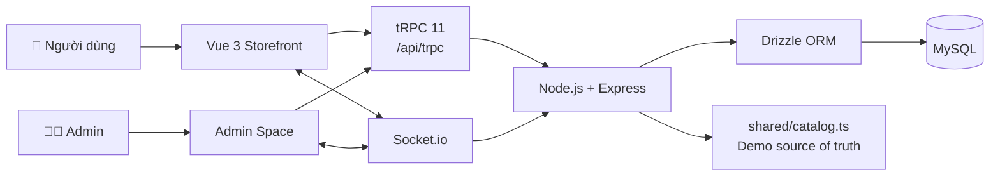
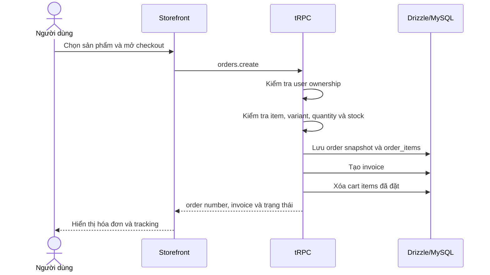
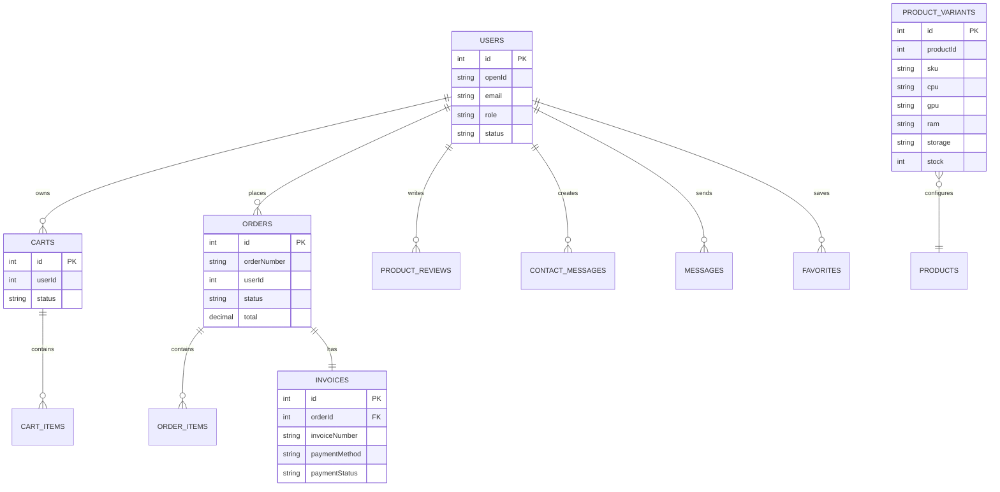

<div align="center">

# 🖥️ NEXA Laptop Store

### Công cụ mạnh. Ý tưởng rộng.

Website thương mại điện tử demo cho laptop, PC, linh kiện và thiết bị công nghệ — kết hợp storefront responsive, PC Builder, giỏ hàng, checkout, theo dõi đơn hàng và Admin Dashboard.

[](#-tr%E1%BA%A1ng-th%C3%A1i-d%E1%BB%B1-%C3%A1n)
[](#-tr%E1%BA%A1ng-th%C3%A1i-d%E1%BB%B1-%C3%A1n)
[](#-license)
[](https://www.typescriptlang.org/)
[](https://vuejs.org/)
[](https://nodejs.org/)
[](https://trpc.io/)
[](https://orm.drizzle.team/)
[](https://socket.io/)

[🚀 Chạy local](#-c%C3%A0i-%C4%91%E1%BA%B7t-v%C3%A0-ch%E1%BA%A1y) · [📖 Kiến trúc](#%EF%B8%8F-ki%E1%BA%BFn-tr%C3%BAc-h%E1%BB%87-th%E1%BB%91ng) · [🛠️ PC Builder](#%EF%B8%8F-pc-builder) · [🐛 Báo lỗi](#-%C4%91%C3%B3ng-g%C3%B3p)

</div>

> [!IMPORTANT]
> NEXA hiện là **bản demo có thể chạy được**, chưa phải hệ thống e-commerce production. Catalog dùng dữ liệu chung trong `shared/catalog.ts`; một số luồng storefront như cart, order, favorites và auth demo vẫn có phần lưu bằng `localStorage`. Schema MySQL, Drizzle migrations và tRPC procedures đã được chuẩn bị để chuyển dần sang dữ liệu thật.

## 📑 Mục lục

- [📌 Tổng quan](#-t%E1%BB%95ng-quan)

- [🎯 Bài toán và giải pháp](#-b%C3%A0i-to%C3%A1n-v%C3%A0-gi%E1%BA%A3i-ph%C3%A1p)

- [📊 Trạng thái dự án](#-tr%E1%BA%A1ng-th%C3%A1i-d%E1%BB%B1-%C3%A1n)

- [🖼️ Demo và screenshots](#%EF%B8%8F-demo-v%C3%A0-screenshots)

- [✨ Tính năng](#-t%C3%ADnh-n%C4%83ng)

- [🏗️ Kiến trúc hệ thống](#%EF%B8%8F-ki%E1%BA%BFn-tr%C3%BAc-h%E1%BB%87-th%E1%BB%91ng)

- [🧰 Tech stack](#-tech-stack)

- [⚙️ Cài đặt và chạy](#%EF%B8%8F-c%C3%A0i-%C4%91%E1%BA%B7t-v%C3%A0-ch%E1%BA%A1y)

- [🔐 Tài khoản demo](#-t%C3%A0i-kho%E1%BA%A3n-demo)

- [🗺️ Routes chính](#%EF%B8%8F-routes-ch%C3%ADnh)

- [🔌 API tRPC](#-api-trpc)

- [🛠️ PC Builder](#%EF%B8%8F-pc-builder)

- [🗃️ Mô hình dữ liệu](#%EF%B8%8F-m%C3%B4-h%C3%ACnh-d%E1%BB%AF-li%E1%BB%87u)

- [📂 Cấu trúc dự án](#-c%E1%BA%A5u-tr%C3%BAc-d%E1%BB%B1-%C3%A1n)

- [🧪 Kiểm thử](#-ki%E1%BB%83m-th%E1%BB%AD)

- [🔒 Bảo mật và giới hạn demo](#-b%E1%BA%A3o-m%E1%BA%ADt-v%C3%A0-gi%E1%BB%9Bi-h%E1%BA%A1n-demo)

- [🗺️ Roadmap](#%EF%B8%8F-roadmap)

- [🤝 Đóng góp](#-%C4%91%C3%B3ng-g%C3%B3p)

- [📄 License](#-license)

- [🙏 Acknowledgments](#-acknowledgments)

## 📌 Tổng quan

> **Chọn đúng thiết bị. Hiểu rõ cấu hình. Mua sắm tự tin hơn.**

NEXA Laptop Store là dự án storefront kết hợp khu vực quản trị dành cho cửa hàng laptop và thiết bị công nghệ. Giao diện sử dụng nền sáng, chữ navy, điểm nhấn electric blue và biểu tượng sói xanh inline SVG. Layout ưu tiên khả năng đọc thông số kỹ thuật, thao tác nhanh trên desktop và responsive trên mobile/tablet.

Dự án được tổ chức theo hướng:

- **Storefront:** catalog, tìm kiếm, sản phẩm nổi bật, chi tiết sản phẩm, cart, checkout, orders, contact và PC Builder.

- **Admin Space:** dashboard, sản phẩm, danh mục, thương hiệu, tồn kho, đơn hàng, hộp thư và người dùng.

- **Backend foundation:** Node.js, Express, tRPC, Drizzle ORM, MySQL schema và Socket.io.

- **Demo-first:** dữ liệu mẫu và local state giúp dự án chạy được nhanh; các điểm nối database thật được tách riêng để phát triển tiếp.

## 🎯 Bài toán và giải pháp

### ❌ Bài toán

Người mua laptop hoặc người tự build PC thường phải xử lý nhiều thông tin rời rạc: tên sản phẩm, CPU, GPU, RAM, SSD, kích thước màn hình, giá, tồn kho và khả năng tương thích. Nếu không có cách trình bày nhất quán, việc so sánh và ra quyết định trở nên khó khăn, đặc biệt với người mới.

### ✅ Giải pháp của NEXA

- Chuẩn hóa catalog theo nhóm **Laptop, PC, Linh kiện, Phần mềm và Thiết bị văn phòng**.

- Tìm kiếm theo tên, thương hiệu, danh mục và các thông số trong sản phẩm.

- Hiển thị sản phẩm theo thương hiệu, nhóm và trạng thái hàng.

- Trang chi tiết có gallery, giá, rating, thông số CPU/RAM/storage/GPU/màn hình/pin/trọng lượng.

- Mô hình `product_variants` hỗ trợ SKU, cấu hình, điều chỉnh giá và tồn kho riêng.

- PC Builder kiểm tra tương thích cơ bản giữa các lựa chọn và ngân sách.

- Checkout tách khỏi cart drawer, có người nhận, địa chỉ, mã giảm giá, phí vận chuyển và phương thức thanh toán.

- Admin có thể theo dõi tồn kho, đơn hàng, thanh toán và trao đổi với khách hàng.

## 📊 Trạng thái dự án

| Hạng mục                 | Trạng thái         | Ghi chú                                                      |
| ------------------------ | ------------------ | ------------------------------------------------------------ |
| Storefront responsive    | ✅ Hoàn thành demo | Vue 3, responsive desktop/tablet/mobile                      |
| Catalog                  | ✅ Hoàn thành demo | 53 sản phẩm trong `shared/catalog.ts`                        |
| Tìm kiếm và nhóm catalog | ✅ Hoàn thành      | Query, category, group và sắp xếp phía giao diện             |
| Product detail           | ✅ Hoàn thành      | Gallery và bảng thông số                                     |
| PC Builder               | ✅ Hoàn thành demo | Kiểm tra tương thích cơ bản                                  |
| Cart và checkout         | ✅ Hoàn thành demo | Có kiểm tra tồn kho; UI còn dùng local state ở một số luồng  |
| Order tracking           | ✅ Hoàn thành demo | Timeline và trạng thái đơn                                   |
| Admin Dashboard          | ✅ Hoàn thành demo | Product, category, brand, inventory, orders, contacts, users |
| tRPC backend             | ✅ Đã có nền tảng  | Procedure public/protected/admin                             |
| MySQL/Drizzle            | 🟡 Đã chuẩn bị     | Schema và migrations có sẵn; cần seed và nối toàn bộ UI      |
| Authentication           | 🟡 Demo            | Chưa xem là auth production                                  |
| Payment gateway          | 🟡 Mô phỏng        | VietQR/MoMo/ZaloPay trên UI; chưa có webhook thật            |
| Production hardening     | ⏳ Chưa hoàn thành | Cần session, rate limit, CSRF, 2FA và kiểm soát Socket.io    |

## 🖼️ Demo và screenshots

### 🎬 GIF demo


> File GIF trên là placeholder tài liệu. Khi chụp demo thực tế, nên đặt asset tại `client/public/assets/demo-home.gif` hoặc cập nhật đường dẫn ảnh trong README.

### 📸 Bộ ảnh nên chụp

| Trang chủ                                                       | Catalog và tìm kiếm                                           |
| --------------------------------------------------------------- | ------------------------------------------------------------- |
|  |  |

| Chi tiết sản phẩm                                                      | PC Builder                                                     |
| ---------------------------------------------------------------------- | -------------------------------------------------------------- |
|  |  |

| Cart và checkout                                                | Admin Dashboard                                                          |
| --------------------------------------------------------------- | ------------------------------------------------------------------------ |
|  |  |

> Các ảnh trong bảng là đường dẫn placeholder. Gói mã nguồn hiện có banner SVG và product SVG trong `client/public/assets/images/`, nhưng chưa kèm bộ screenshot README hoàn chỉnh.

## ✨ Tính năng

### 👤 Storefront người dùng

- Trang chủ với hero slider tự động, CTA và category cards.

- Banner autoplay, indicator chuyển slide và hiệu ứng hover/floating nhẹ.

- Catalog phân nhóm Laptop, PC, Linh kiện, Phần mềm và Thiết bị văn phòng.

- Tìm kiếm theo tên, thương hiệu, danh mục hoặc thông số.

- Sắp xếp theo nổi bật, giá thấp, giá cao và rating.

- Phân trang catalog để tránh render toàn bộ danh sách cùng lúc.

- Product detail với gallery thumbnail, rating, giá, tồn kho và bảng thông số.

- Sản phẩm yêu thích với optimistic UI và favorites procedures ở backend.

- Responsive cho desktop, tablet và mobile.

### 🛒 Cart, checkout và order

- Thêm sản phẩm và biến thể vào cart.

- Cập nhật số lượng, xóa dòng hàng và kiểm tra giới hạn tồn kho.

- Phí vận chuyển miễn phí từ **5.000.000 ₫** theo logic demo.

- Coupon demo `NEXA10`.

- Checkout gồm tên người nhận, số điện thoại, địa chỉ, ghi chú và phương thức thanh toán.

- Phương thức demo: COD, chuyển khoản ngân hàng, VietQR, MoMo/ZaloPay ở lớp giao diện.

- Lưu thông tin đơn, trạng thái giao hàng, trạng thái thanh toán và invoice number trong nền tảng backend.

- Order timeline: chờ xác nhận → xác nhận/đóng gói → giao hàng → đã giao; có trạng thái hủy.

- Modal hóa đơn hiển thị mã đơn, sản phẩm, số lượng, đơn giá, phí, giảm giá, tổng tiền và người nhận.

### 🛠️ PC Builder

- Chọn CPU, GPU, RAM, SSD và ngân sách.

- Cảnh báo compatibility cơ bản.

- Có thể đưa cấu hình vào cart hoặc gửi yêu cầu tư vấn.

- Quy tắc nâng cao về kích thước case, cổng kết nối và tản nhiệt được để trong roadmap.

### 👨‍💼 Admin Space

- Route quản trị tách khỏi storefront bằng layout riêng.

- Tổng quan với KPI demo, doanh thu, đơn hàng mới, giá trị đơn trung bình và tồn kho cảnh báo.

- Danh sách và thao tác demo với sản phẩm.

- Thêm/xóa danh mục và xem nhóm thương hiệu.

- Điều chỉnh số lượng tồn kho trực tiếp.

- Cập nhật trạng thái giao hàng và thanh toán của đơn.

- Hộp thư liên hệ: xem, đánh dấu đã đọc và gửi phản hồi.

- Người dùng và role `user`/`admin`.

- `adminProcedure` chặn các procedure quản trị khi role không phải `admin`.

### ⚡ Realtime và trải nghiệm

Socket.io được gắn trên cùng HTTP server với tRPC. Các event hiện có trong lớp realtime:

| Event               | Mục đích                      |
| ------------------- | ----------------------------- |
| `order:updated`     | Đồng bộ trạng thái giao hàng  |
| `payment:updated`   | Đồng bộ trạng thái thanh toán |
| `inventory:updated` | Đồng bộ thay đổi tồn kho      |
| `contact:message`   | Thông báo tin nhắn mới        |
| `contact:reply`     | Thông báo phản hồi Admin      |

Ngoài ra, CSS có animation cho header, hero, product card, drawer, toast và dashboard; có xử lý `prefers-reduced-motion`.

## 🏗️ Kiến trúc hệ thống



### Luồng khởi động server

1. `server/_core/index.ts` tạo Express app và HTTP server.

1. Socket.io được gắn vào HTTP server.

1. Storage proxy và OAuth routes được đăng ký.

1. tRPC được mount tại `/api/trpc`.

1. Development dùng Vite middleware; production phục vụ static build.

1. Server ưu tiên `PORT` hoặc port `3000`, sau đó tự tìm một port trống trong khoảng tiếp theo nếu port bị chiếm.

### Luồng tạo đơn



## 🧰 Tech stack

| Nhóm           | Công nghệ                               | Vai trò thực tế                          |
| -------------- | --------------------------------------- | ---------------------------------------- |
| Frontend chính | Vue 3, Vite, TypeScript                 | Storefront và các màn hình tương tác     |
| Styling        | CSS, Tailwind CSS, responsive layout    | Design tokens, layout và animation       |
| Backend        | Node.js, Express                        | HTTP server và runtime                   |
| API            | tRPC 11, Zod, SuperJSON                 | API type-safe và validation              |
| ORM/database   | Drizzle ORM, MySQL, `mysql2`            | Schema, query helpers và migrations      |
| Realtime       | Socket.io, Socket.io Client             | Event giữa User/Admin và server          |
| Icons          | `lucide-vue-next`, `lucide-react`       | Icon giao diện                           |
| UI scaffold    | Radix UI packages, React Query packages | Một phần scaffold/components có sẵn      |
| Auth/runtime   | OAuth integration, cookies, `jose`      | Hạ tầng runtime; flow demo cần hardening |
| Storage        | S3 SDK và storage proxy                 | Hạ tầng lưu trữ/runtime có sẵn           |
| Testing        | Vitest, TypeScript compiler             | Unit test procedure và type check        |
| Tooling        | pnpm 10.4.1, Prettier, esbuild, tsx     | Cài đặt, format, build và dev watch      |

> `package.json` còn chứa một số dependency React/Radix từ scaffold tích hợp. Storefront hiện tại sử dụng Vue 3; không nên suy ra rằng toàn bộ các dependency scaffold đều là tính năng đang dùng trong sản phẩm.

## ⚙️ Cài đặt và chạy

### Yêu cầu

| Thành phần         | Phiên bản                                                |
| ------------------ | -------------------------------------------------------- |
| Node.js            | 20 trở lên                                               |
| pnpm               | 10 trở lên; package manager của project là `pnpm@10.4.1` |
| Visual Studio Code | Khuyến nghị                                              |
| MySQL              | Chỉ cần khi bật luồng database thật                      |
| RAM                | Khuyến nghị từ 4 GB                                      |

### macOS/Linux

```bash
# 1. Giải nén và đi vào thư mục có package.json
cd /path/to/nexa-laptop-store-vscode

# 2. Cài dependency theo pnpm-lock.yaml
pnpm install

# 3. Chạy môi trường development
pnpm dev
```

### Windows PowerShell

```
# 1. Mở đúng thư mục gốc của dự án
cd "C:\Users\Admin\Downloads\nexa-laptop-store-vscode"

# 2. Xác nhận package.json tồn tại
Get-ChildItem package.json

# 3. Cài và chạy bằng pnpm.cmd nếu PowerShell chặn script .ps1
pnpm.cmd install
pnpm.cmd dev
```

Nếu máy chưa có pnpm hoặc Corepack bị lỗi quyền:

```
npx.cmd --yes pnpm@10.4.1 install
npx.cmd --yes pnpm@10.4.1 dev
```

Server thường chạy tại `http://localhost:3000/`. Nếu port 3000 đang bận, server sẽ tự chọn port trống tiếp theo và in URL trong terminal.

### Các script

| Lệnh             | Mục đích                                               |
| ---------------- | ------------------------------------------------------ |
| `pnpm dev`       | Chạy `tsx watch server/_core/index.ts`                 |
| `pnpm run check` | Chạy TypeScript compiler với `--noEmit`                |
| `pnpm test`      | Chạy Vitest một lần                                    |
| `pnpm run build` | Build frontend bằng Vite và bundle server bằng esbuild |
| `pnpm start`     | Chạy `dist/index.js` ở production mode                 |
| `pnpm db:push`   | Generate và migrate Drizzle schema                     |
| `pnpm format`    | Format mã nguồn bằng Prettier                          |

### Database

Bản demo có thể chạy với dữ liệu catalog dùng chung và local state theo thiết kế hiện tại. Khi bật MySQL, đặt `DATABASE_URL` trong môi trường chạy rồi thực hiện:

```bash
# Sinh migration từ schema và migrate database
pnpm db:push
```

Không commit connection string thật, secret hoặc `.env` vào Git.

## 🔐 Tài khoản demo

| Role  | Email              | Password    | Route          |
| ----- | ------------------ | ----------- | -------------- |
| User  | `user@demo.com`    | `123456`    | `/login`       |
| Admin | `admin@nexa.store` | `admin123!` | `/admin/login` |

> Đây là thông tin trình diễn local. Không sử dụng các credential này trên Internet hoặc trong môi trường production. Admin không có form đăng ký công khai; route `/admin/*` yêu cầu trạng thái Admin hợp lệ.

## 🗺️ Routes chính

| Route              | Khu vực    | Mô tả                                      |
| ------------------ | ---------- | ------------------------------------------ |
| `/`                | Storefront | Trang chủ, hero slider và sản phẩm nổi bật |
| `/laptops`         | Storefront | Catalog, tìm kiếm, nhóm và sắp xếp         |
| `/product/:id`     | Storefront | Chi tiết sản phẩm và thông số              |
| `/builder`         | Storefront | PC Builder                                 |
| `/orders`          | User       | Lịch sử và tracking đơn hàng               |
| `/contact`         | User       | Form liên hệ và hội thoại hỗ trợ           |
| `/login`           | User       | Đăng nhập demo                             |
| `/register`        | User       | Đăng ký demo                               |
| `/my-favorites`    | User       | Sản phẩm yêu thích                         |
| `/admin/login`     | Admin      | Đăng nhập khu vực quản trị                 |
| `/admin/dashboard` | Admin      | Dashboard và các module vận hành           |

## 🔌 API tRPC

HTTP endpoint của tRPC được mount tại:

```
/api/trpc
```

Các procedure chính:

| Nhóm      | Procedure              | Quyền     | Mô tả                                                   |
| --------- | ---------------------- | --------- | ------------------------------------------------------- |
| Auth      | `auth.me`              | Public    | Lấy user hiện tại hoặc `undefined`                      |
| Auth      | `auth.logout`          | Public    | Xóa session cookie                                      |
| Catalog   | `catalog.list`         | Public    | Tìm kiếm theo `query`, `category`, `group`              |
| Catalog   | `catalog.getById`      | Public    | Lấy một sản phẩm theo id                                |
| Catalog   | `catalog.variants`     | Public    | Lấy variant; fallback về cấu hình demo nếu DB chưa seed |
| Cart      | `cart.list`            | Protected | Lấy cart của user hiện tại                              |
| Cart      | `cart.add`             | Protected | Thêm sản phẩm/variant và kiểm tra stock                 |
| Cart      | `cart.update`          | Protected | Cập nhật quantity của item thuộc user                   |
| Cart      | `cart.remove`          | Protected | Xóa item thuộc user                                     |
| Orders    | `orders.mine`          | Protected | Lấy các đơn của user                                    |
| Orders    | `orders.detail`        | Protected | Xem chi tiết đơn thuộc user                             |
| Orders    | `orders.create`        | Protected | Tạo order và invoice từ cart items                      |
| Orders    | `orders.updateStatus`  | Admin     | Đổi trạng thái giao hàng                                |
| Orders    | `orders.updatePayment` | Admin     | Đổi trạng thái thanh toán                               |
| Reviews   | `reviews.list`         | Public    | Lấy review đã publish                                   |
| Reviews   | `reviews.submit`       | Protected | Gửi review với trạng thái `pending`                     |
| Contact   | `contact.send`         | Public    | Gửi yêu cầu liên hệ                                     |
| Contact   | `contact.mine`         | Protected | Lấy contact của user                                    |
| Contact   | `contact.reply`        | Admin     | Admin trả lời contact                                   |
| Messages  | `messages.mine`        | Protected | Lấy tin nhắn của user                                   |
| Messages  | `messages.send`        | Protected | Gửi tin nhắn trong conversation                         |
| Messages  | `messages.markRead`    | Protected | Đánh dấu hội thoại đã đọc                               |
| Messages  | `messages.adminList`   | Admin     | Lấy danh sách tin nhắn cho Admin                        |
| Favorites | `favorites.list`       | Protected | Lấy favorites của user                                  |
| Favorites | `favorites.check`      | Protected | Kiểm tra trạng thái yêu thích                           |
| Favorites | `favorites.toggle`     | Protected | Thêm/bỏ yêu thích                                       |
| Favorites | `favorites.remove`     | Protected | Xóa yêu thích                                           |
| Admin     | `admin.summary`        | Admin     | KPI dashboard demo                                      |
| Admin     | `admin.products`       | Admin     | Danh sách sản phẩm quản trị                             |
| Admin     | `admin.users`          | Admin     | Danh sách user demo                                     |
| Admin     | `admin.orders`         | Admin     | Danh sách đơn hàng                                      |
| Admin     | `admin.contacts`       | Admin     | Danh sách contact                                       |

Ví dụ gọi catalog bằng tRPC client:

```
const products = await trpc.catalog.list.query({
  query: "RTX 4060",
  group: "Linh kiện",
} );
```

## 🛠️ PC Builder

### Workflow

1. Chọn nhóm cấu hình và ngân sách.

1. Chọn CPU, GPU, RAM và SSD.

1. Hệ thống đọc thông số từ catalog/variant.

1. Kiểm tra compatibility cơ bản và hiển thị cảnh báo.

1. Thêm cấu hình vào cart hoặc gửi yêu cầu tư vấn.

### Logic hiện tại

| Quan hệ               | Kiểm tra                                       |
| --------------------- | ---------------------------------------------- |
| CPU ↔ mainboard      | Socket cơ bản                                  |
| RAM ↔ mainboard      | Chuẩn RAM cơ bản                               |
| GPU ↔ PSU            | Công suất nguồn ở mức cảnh báo                 |
| Cấu hình ↔ ngân sách | Tổng tiền so với ngân sách                     |
| Sản phẩm ↔ tồn kho   | Variant hoạt động và quantity không vượt stock |

### Giới hạn

PC Builder hiện là công cụ demo. Chưa nên xem các cảnh báo là kiểm tra phần cứng đầy đủ; các quy tắc về kích thước case, số khe/cổng, tản nhiệt, clearance GPU và công suất PSU chi tiết sẽ được bổ sung trong roadmap.

## 🗃️ Mô hình dữ liệu

Schema Drizzle hiện có các nhóm bảng sau:



Các bảng liên quan đến auth và audit gồm `password_reset_tokens`, `login_logs`, `admin_audit_logs`, `favorite_collections` và `favorites`. Commerce schema gồm `product_variants`, `carts`, `cart_items`, `orders`, `order_items`, `invoices`, `product_reviews`, `contact_messages` và `messages`.

## 📂 Cấu trúc dự án

```
📦 nexa-laptop-store-vscode
├── 📂 client/
│   ├── 📄 index.html
│   ├── 📂 public/assets/
│   │   └── 📂 images/
│   │       ├── 📂 banners/             # 5 banner SVG
│   │       └── 📂 products/            # 8 ảnh SVG dùng lại cho catalog
│   └── 📂 src/
│       ├── 📄 App.vue                  # Storefront và Admin UI chính
│       ├── 📄 App.tsx                  # Scaffold/integration có sẵn
│       ├── 📄 main.ts                  # Vue entry
│       ├── 📄 main.tsx                 # Scaffold entry có sẵn
│       ├── 📄 index.css                # Design tokens, responsive CSS, animation
│       ├── 📂 components/              # UI components và Radix scaffold
│       ├── 📂 contexts/                # Theme context
│       ├── 📂 hooks/                   # Responsive/persistence utilities
│       ├── 📂 lib/                     # tRPC client và helpers
│       └── 📂 pages/                   # Một số page/scaffold components
├── 📂 server/
│   ├── 📂 _core/                       # Context, auth, Vite, OAuth, storage, runtime
│   ├── 📄 db.ts                        # Database helpers
│   ├── 📄 routers.ts                   # tRPC appRouter và adminProcedure
│   ├── 📄 realtime.ts                  # Socket.io event bridge
│   ├── 📄 storage.ts                   # Storage helpers
│   ├── 📄 auth.logout.test.ts          # Test auth logout
│   └── 📄 catalog-admin.test.ts        # Test catalog và quyền Admin
├── 📂 shared/
│   ├── 📄 catalog.ts                   # 53 sản phẩm và demo types
│   ├── 📄 types.ts                     # Shared types
│   ├── 📄 const.ts                     # Shared constants
│   └── 📂 _core/                       # Shared error helpers
├── 📂 drizzle/
│   ├── 📄 schema.ts                    # MySQL schema
│   ├── 📄 relations.ts                 # Relations
│   ├── 📂 migrations/                  # Migration metadata/files
│   └── 📄 000*.sql                     # Các migration đã sinh
├── 📂 patches/                         # Package patches
├── 📄 package.json                     # Scripts và dependency
├── 📄 pnpm-lock.yaml                   # Dependency lockfile
├── 📄 vite.config.ts
├── 📄 tsconfig.json
├── 📄 vitest.config.ts
├── 📄 drizzle.config.ts
├── 📄 RUN_IN_VSCODE.md                 # Hướng dẫn Windows/VS Code
├── 📄 todo.md                          # Checklist phát triển
└── 📄 README.md
```

## 🧪 Kiểm thử

Chạy các lệnh sau từ thư mục có `package.json`:

```bash
# Kiểm tra TypeScript
pnpm run check

# Chạy Vitest một lần
pnpm test

# Build frontend và server bundle
pnpm run build
```

Phạm vi test hiện có:

- `catalog.list` lọc sản phẩm theo query và group.

- User thường bị từ chối khi gọi procedure Admin.

- Admin có thể đọc dữ liệu summary.

- Auth logout có test riêng.

Kết quả checkpoint được ghi nhận: TypeScript không lỗi và Vitest đạt **4/4 test trong 2 test file**. Khi mở rộng sang production, nên bổ sung integration test cho auth, cart, order ownership, payment update, contact và favorites; mục tiêu coverage tối thiểu là 80%.

## 🔒 Bảo mật và giới hạn demo

### Chưa production-ready

- Form đăng nhập và tài khoản demo phục vụ trình diễn local; cần session/auth hoàn chỉnh.

- Mật khẩu demo không được dùng khi triển khai công khai.

- VietQR, MoMo và các luồng thanh toán hiện là mô phỏng UI; cần payment API có signature, webhook, idempotency và đối soát.

- Socket.io hiện có các event relay từ client; trước khi public cần xác thực session và quyền Admin ở tầng socket.

- Một số trạng thái cart, order và favorites trên storefront vẫn dùng `localStorage`.

- KPI dashboard hiện có số liệu demo trong procedure `admin.summary`.

### Không commit

- `DATABASE_URL` thật.

- `JWT_SECRET`, OAuth secret hoặc API key.

- Cookie/session production.

- File `.env` có thông tin nhạy cảm.

- Credential của tài khoản production.

## 🗺️ Roadmap

### Đã hoàn thành trong demo

- [x] Storefront responsive và Admin Space riêng.

- [x] Catalog 53 sản phẩm, 5 nhóm sản phẩm và 5 banner.

- [x] Tìm kiếm, nhóm, sắp xếp và phân trang catalog.

- [x] Product detail với gallery và thông số.

- [x] Product variants theo SKU, cấu hình và tồn kho.

- [x] Cart, checkout, invoice và order tracking demo.

- [x] PC Builder với compatibility check cơ bản.

- [x] Admin product/category/brand/inventory/order/contact/user views.

- [x] Review pending workflow và favorites procedures.

- [x] Socket.io event bridge.

- [x] Type checking và test backend cơ bản.

### Ưu tiên tiếp theo

- [ ] Chuyển toàn bộ cart, orders, contact và favorites UI sang database thật.

- [ ] Hoàn thiện session cookie, password hashing và auth flow production.

- [ ] Bổ sung rate limiting, CSRF, reset password và 2FA cho Admin.

- [ ] Khóa các Socket.io event bằng session và role.

- [ ] Tích hợp payment gateway thật với webhook/đối soát.

- [ ] Bổ sung shipping provider, email xác nhận và voucher production.

- [ ] Mở rộng PC Builder: socket chi tiết, kích thước case, clearance, PSU và tản nhiệt.

- [ ] Bổ sung integration/e2e tests và coverage tối thiểu 80%.

- [ ] Bổ sung screenshot/GIF thật cho README và deploy preview công khai.

- [ ] Tách App Vue lớn thành các module/page/feature dễ bảo trì hơn.

## 🤝 Đóng góp

1. Fork repository.

1. Tạo branch:

   ```
   feature/<ten-tinh-nang>
   fix/<ten-loi>
   docs/<ten-tai-lieu>
   ```

1. Viết commit theo Conventional Commits:

   ```
   feat(pc-builder): add PSU warning
   fix(cart): validate stock before update
   docs(readme): document Windows setup
   ```

1. Chạy `pnpm run check`, `pnpm test` và `pnpm run build`.

1. Tạo Pull Request với mô tả thay đổi, ảnh giao diện và cách kiểm thử.

Nếu đóng góp thay đổi giao diện, hãy kiểm tra tối thiểu ở desktop và mobile; nếu thêm procedure, hãy bổ sung test cho quyền truy cập và ownership.

## 📄 License

Dự án được khai báo **MIT License** trong `package.json`. Khi phát hành repository công khai, nên thêm file `LICENSE` chứa nội dung đầy đủ của MIT License.

## 🙏 Acknowledgments

- [Vue](https://vuejs.org/) và [Vite](https://vitejs.dev/) cho frontend.

- [TypeScript](https://www.typescriptlang.org/) cho static typing.

- [tRPC](https://trpc.io/) cho API type-safe.

- [Drizzle ORM](https://orm.drizzle.team/) và [MySQL](https://www.mysql.com/) cho data layer.

- [Socket.io](https://socket.io/) cho realtime communication.

- [Lucide](https://lucide.dev/) cho icon system.

- [Vitest](https://vitest.dev/) cho kiểm thử.

- [Mermaid](https://mermaid.js.org/) và [Shields.io](https://shields.io/) cho tài liệu README.

<div align="center">

⭐ Nếu NEXA hữu ích, hãy để lại một star sau khi repository được publish.

**NEXA Laptop Store — Công cụ mạnh. Ý tưởng rộng.**

</div>
